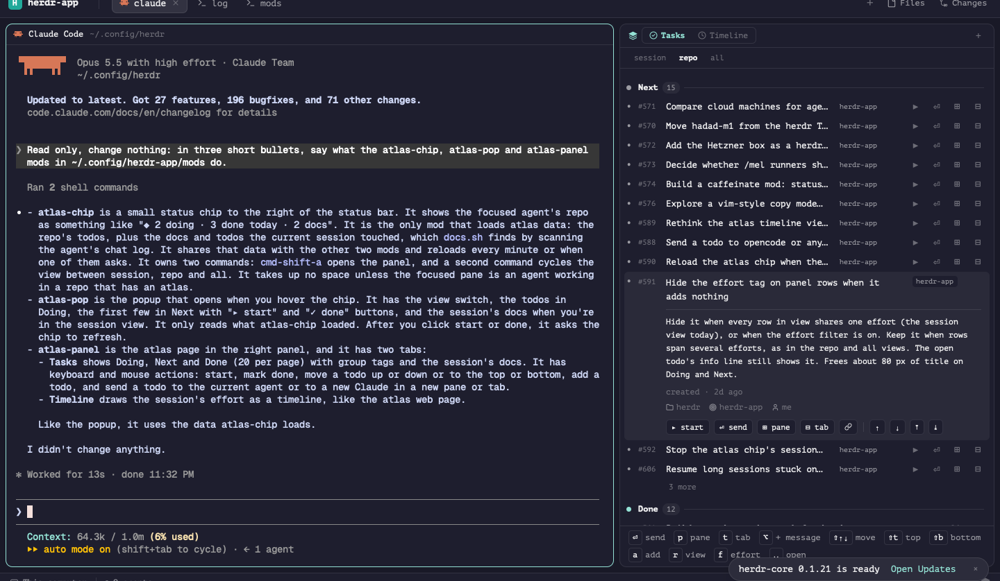
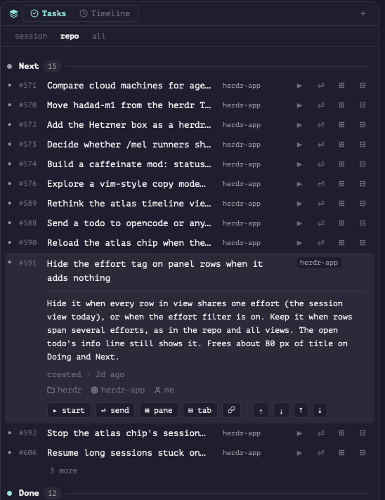
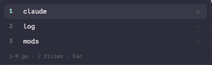
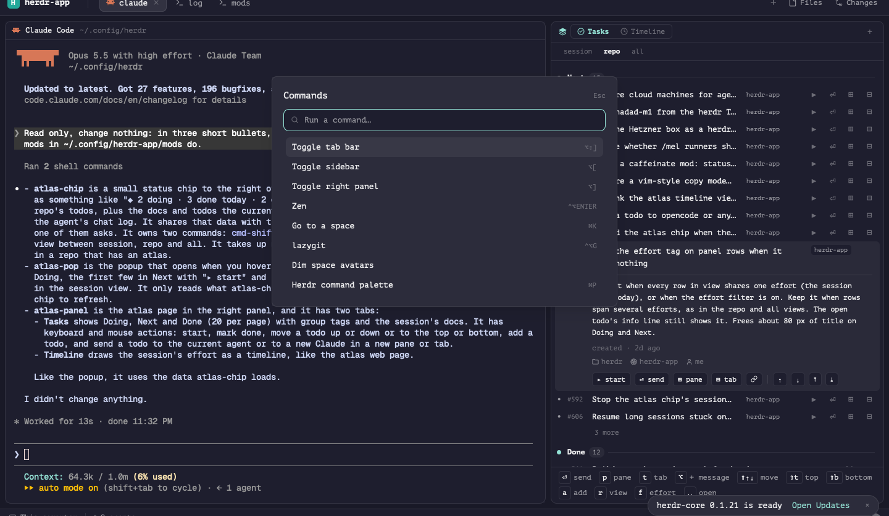

# herdr-app config

My setup for [Herdr](https://herdr.dev), the desktop app that runs coding agents and terminals in spaces and tabs. It holds my layouts, keys, themes, a few small tools, and the mods I wrote, including three that put my [Atlas](https://github.com/dusmel/atlas) todos next to the agent working on them.



## What's in it

| Path | What it holds |
|---|---|
| `layouts/mine.json` | The window I use: our own tab bar, pane header and status bar, a right panel with Files, Changes and Atlas pages, and the window buttons moved off screen |
| `layouts/zen.json` | The same layout with the sidebar, tab bar and panel hidden |
| `keys.json`, `settings.json` | Key bindings, font, theme and zoom |
| `themes/` | Catppuccin, Atom One Dark and Win98 colours |
| `mods/` | Herdr's stock mods, my copies of four of them (`my-*`), and my own mods |
| `custom/` | What an update needs: `manifest.json` says why each copy and own mod exists, and `CHECK.md` is the playbook for merging a new release into the copies |
| `tools/` | `live-shot` (a screenshot that is known to be current), `reclone` (keeps the copies in step with updates), `herdr-onscreen` (tells `live-shot` whether the window is drawing) |
| `migrate/` | The scripts that moved my spaces and running Claude sessions over from the herdr TUI |

## Atlas in the window

`atlas-chip` sits in the status bar and shows what the focused agent's repo has in progress: `◆ 2 doing · 3 done today · 2 docs`. Hover it for a short list. Press `cmd-shift-a` for the full page in the right panel.

The panel has three views: this Claude session's todos, the repo's, or all of them. Open a todo to start it, mark it done, move it, or send it to an agent in this pane, a new pane or a new tab.



The atlas mods need the `atlas` CLI to be logged in (`~/.config/atlas/config.json`), and they show only when the space's folder has an `atlas/` link. Without either, they take no space.

## Keys for my own mods

| Key | Mod | Does |
|---|---|---|
| `cmd-k` | `space-jump` | Switch spaces, with each space's worktrees under it |
| `cmd-alt-k` | `tab-jump` | Switch tabs in the shown space. Number keys go there, `/` filters |
| `cmd-m` | `pane-pick` | Put a letter in each pane's header, then jump to the pane by its letter |
| `alt-tab` | `pane-back` | Go back to the pane you were in before, in any space |
| `ctrl-1`…`ctrl-9` | `go-space-N` | Go to the Nth space, not counting worktrees |
| `cmd-alt-p` | `commands` | A short command list, each with its key |
| `ctrl-alt-enter` | `zen` | Switch between `mine` and `zen` |
| `ctrl-alt-g` | `lazygit` | Open lazygit in a floating window |
| `cmd-shift-a` | `atlas-chip` | Open the atlas panel |
| `alt-]` | layout | Show or hide the right panel |





## Use it

1. Quit Herdr and move your own `~/.config/herdr-app` aside.
2. Clone this repo there:

	```sh
	git clone https://github.com/dusmel/herdr-app-config.git ~/.config/herdr-app
	```

3. Start Herdr. It writes `AGENTS.md`, the `.d.ts` files and its state files on start. `.gitignore` keeps them out of git.
4. To use my layout, run `herdr-app do layout.switch --name mine`.

The `my-*` copies don't get Herdr's updates by themselves. After an update, the status bar shows a pill. It opens a Claude tab that follows `custom/CHECK.md` and merges the new stock files into the copies with `tools/reclone`.

## Rules for changes

`CLAUDE.md` holds the rules I give agents working here. The short version:

- Use the lightest change that works: a setting or key first, then an own mod, and copy a stock mod only when the change has to live inside it.
- Keep the app light. A mod must not start a process on a timer, must do nothing while hidden, and must read only the new bytes of a file.
- Check every change with `herdr-app check mods/<name>` and look at it with `tools/live-shot`.

## License

Apache 2.0, the same license as Herdr. The stock mods in `mods/` and the copies in `custom/` are Herdr's. The Win98 terminal font is PxPlus IBM VGA 8x16 from int10h.org, under CC BY-SA 4.0.
